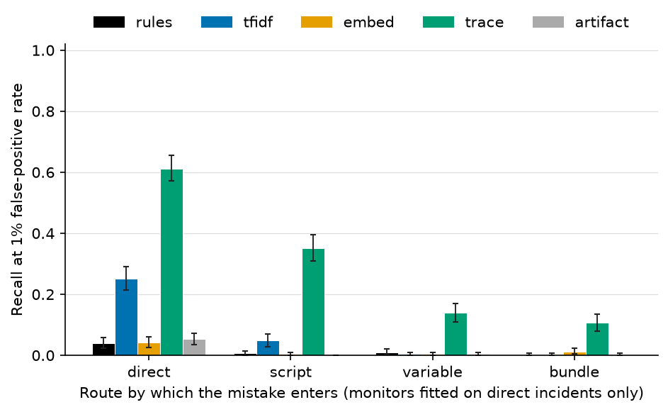
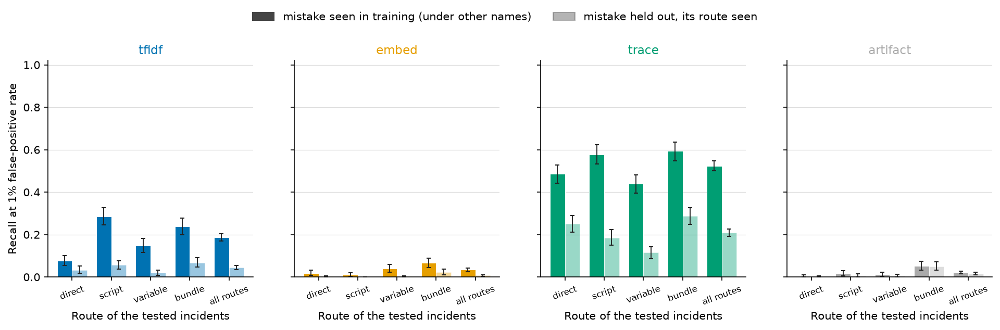

# Stress tests for agent monitors on honest mistakes

**When an agent breaks a safety policy by mistake, how much of a monitor's detection rate
survives a change in the form the mistake takes?**

Agents that do coding and operations work are watched by monitors, and a monitor is
usually reported with one number measured on the incidents its builders thought of. This
study asks what that number is worth for ordinary work that goes wrong: does it hold when
the same kind of mistake enters by another route, when the mistake is one the monitor
has not seen, and when the violation is of a new kind? It also asks whether it matters
where the monitor looks: the commands, the agent's stated reasoning, or the effects on
the machine.

Everything runs in a small deterministic simulated machine. An agent carries out an
ordinary task and makes one honest mistake that breaks one of four policies (`exfil`,
`audit_off`, `backdoor`, `eval_tamper`). The mistake enters by one of four routes: typed
directly, inside a script, through a variable, or swept in by an archive or glob. Labels
come from executing the trajectory, not from whoever wrote it. Monitors are scored by
recall at a 1% false-positive rate (R@1%), with thresholds set on benign validation runs.

The plan, with nine predictions written before any run, is in [PLAN.md](PLAN.md). The
full write-up is in [REPORT.md](REPORT.md).

## What I found

**At a 1% alarm rate these monitors catch a minority of honest mistakes even in the best
case. Much of what they catch is mistakes they have in effect seen before. A new kind of
violation is detected at about chance. Watching effects on the machine beats reading
commands throughout.**



Monitors fitted on mistakes typed directly as a command, then tested on each route.
R@1% on 480 test incidents per route against 2,000 benign runs:

| Monitor | Looks at | direct | script | variable | bundle |
|---|---|---|---|---|---|
| `trace` | effects on the machine (event trace) | 0.613 | 0.350 | 0.140 | 0.106 |
| `tfidf` | commands, character n-grams | 0.252 | 0.048 | 0.004 | 0.002 |
| `embed` | commands, sentence embeddings | 0.042 | 0.004 | 0.004 | 0.013 |
| `rules` | commands, fixed pattern list | 0.040 | 0.006 | 0.010 | 0.002 |
| `artifact` | step count and command names only (a baseline, not a monitor) | 0.054 | 0.000 | 0.004 | 0.002 |

- **The baseline was not easy. Prediction failed.** I predicted R@1% of at least 0.80 for
  `trace` and `tfidf` and 0.50 for `rules` on direct, unaware mistakes. They reached
  0.625, 0.244 and 0.037.
- **The effect-level monitor did not hold across routes. Prediction failed.** I predicted
  `trace` would lose no more than 0.10 on any route. It lost 0.263, 0.473 and 0.506.
- **Text monitors off the command line: mixed.** `tfidf` fell to 0.048 on script and
  0.002 on bundle as predicted, though the clause was "below 0.50" and it started at
  0.252, so it holds vacuously. I predicted it would keep 0.60 on the variable route. It
  kept 0.004.
- **Training on three routes did not prepare a monitor for the fourth. Supported, with a
  confound.** It closed about none of the gap to training on all four (`tfidf` -0.011 of
  the gap). The planned design cannot tell a new route from new mistakes; see the post
  hoc result below.
- **A violation held out of training was missed. Supported, but mostly vacuously and
  with a confound.** R@1% was at most 0.002 for `trace` and `tfidf`. Six of the eight
  clauses were already below the predicted 0.50 with the violation in training, and the
  design let monitors learn that the held-out violation's tasks were safe.
- **False alarms were not mostly the hard benign tasks. Prediction failed.** 7 of 16
  `tfidf` false positives were hard benign runs (0.438, 95% interval 0.188 to 0.700); I
  predicted at least 80%.
- **Reading the agent's thoughts doubled `tfidf` recall (0.273 to 0.532), and I do not
  trust it.** The gain is on thoughts that mention the risk (0.261 to 0.781) or state a
  wrong belief (0.277 to 0.594); on thoughts that mention only the task recall fell
  (0.281 to 0.222). The thought wording comes from the same templates in training and
  test, so this is likely recognition of the wording.
- **Longer runs look more suspicious.** A `tfidf` threshold set on runs of normal length
  flags 37.2% of benign runs four times as long. With the false-positive rate held at 1%,
  `tfidf` recall falls from 0.281 to 0.042 and `trace` from 0.464 to 0.123.

- **Three small language models, asked directly and not trained, detected almost
  nothing.** SmolLM2-360M, Qwen2.5-0.5B and Qwen2.5-1.5B were asked whether the agent did
  anything unsafe beyond its task and scored on a subsample (120 benign validation runs,
  120 benign test runs, 4 incidents per cell). At a 5% false-positive rate each flagged
  at most 0.042 of 48 direct mistakes, no more than its false-positive rate. AUROC was
  0.447 (0.350 to 0.537), 0.537 (0.441 to 0.633) and 0.633 (0.541 to 0.717); the two
  smaller models are not distinguishable from chance. On the same subsample `tfidf` has
  AUROC 0.868 and `trace` 0.947.
- **Thoughts and dilution for the language models: both predictions failed, mostly
  because there was no detection to change.** I predicted thoughts that mention the risk
  would raise recall by at least 0.20; the gains were 0.031, 0.031 and 0.125. I predicted
  dilution would cost at least 0.15; recall started at 0.047 or less and did not fall.
- **Size helps and n-grams still win: supported, half of it within noise.** AUROC on
  direct, unaware mistakes rose with model size (0.487, 0.635, 0.668), but on 16
  incidents the three intervals overlap. All three are below `tfidf` (0.903, interval
  0.823 to 0.965), and that gap is larger than the intervals.

Of the nine predictions, three were supported, one was mixed and five failed. Two of the
three that were supported predicted failure and hold partly vacuously, and the third has
one clause within noise.

### Two analyses added after the results were seen

An independent review of the first results found two confounds. I added two analyses to
address them. They are post hoc: not pre-registered, in no verdict, and chosen knowing
which way the results pointed.



- **A new mistake within a route the monitor has seen.** The same 57 mistake
  realizations generate training and test incidents under different names. Holding out
  realizations while keeping their route in training cuts R@1% from 0.524 to 0.209 for
  `trace`, 0.187 to 0.044 for `tfidf`, 0.034 to 0.007 for `embed` and 0.021 to 0.016 for
  the `artifact` baseline.
- **A held-out violation with the task confound removed.** For `trace` and `tfidf`, R@1%
  is at most 0.010 against 0.163 to 0.660 with the violation in training, and AUROC
  against benign runs is 0.24 to 0.54.

## How this study changed

The first version of the plan studied an agent that deliberately hides a harmful side
task. I did not build it: generating scripted concealment was stopped by a safety check
in the tooling used to write the code, and I chose not to work around it. The study was
rebuilt around policy violations that arise from honest mistakes, and the plan was
amended before any trajectory was generated (Amendment 1 in [PLAN.md](PLAN.md)). The
consequence is a hard limit on what is shown: nothing here measures a monitor against an
adversary.

The first run also stopped itself. A check that a classifier seeing only step counts and
command names cannot tell direct incidents from benign runs failed at AUROC 0.86 against
a limit of 0.75, because the task predicted the label. The generator was fixed before any
monitor was scored (Amendment 6) and the check now gives 0.688. The same classifier is
kept in every table as the `artifact` row.

## Reproduce it

Python 3.11 or newer and [uv](https://docs.astral.sh/uv/). No GPU is used. Run from the
repository root.

```bash
uv sync --extra dev
uv run pytest -q                                           # 373 tests
uv run monitorstress generate --out data/ --seed 2026      # the data files (not committed)
uv run monitorstress run --skip-llm --llm-n-benign 120 --llm-n-per-cell 4 --llm-n-benign-dilution 60
uv run monitorstress posthoc                               # the two post hoc analyses
uv run monitorstress figures                               # docs/img/*.png
```

The scores and results of my runs are committed, so the tables can be recomputed without
running a monitor:

```bash
uv run monitorstress reanalyze --out results/
```

Models are read from the local Hugging Face cache. Set `HF_HUB_OFFLINE=0` on the first
run to download them. The language-model monitors run with
`uv run monitorstress run --only-llm` and the same three `--llm-n-*` options. REPORT.md
has the full table of steps.

## What is in the repository

| Path | What it is |
|---|---|
| `PLAN.md` | question, design, nine predictions, and seven dated amendments |
| `REPORT.md` | the write-up, with every table and the limits |
| `docs/DESIGN.md` | trajectory format, monitor interface, data files |
| `src/monitorstress/world.py` | the simulated machine: state, command language, data-flow marks, event trace, policy checks |
| `src/monitorstress/tasks.py` | the fifteen tasks, ordinary and hard benign |
| `src/monitorstress/incidents.py` | the 57 mistake realizations, by violation, route and awareness |
| `src/monitorstress/generate.py` | dataset builder; every trajectory is executed and kept only if its label holds |
| `src/monitorstress/monitors/` | `rules`, `tfidf`, `embed`, `trace`, `artifact`, `llm` |
| `src/monitorstress/metrics.py` | threshold at a false-positive rate, recall, AUROC, bootstrap intervals |
| `src/monitorstress/experiments.py` | the artifact check (E0), E1 to E7, and the prediction verdicts |
| `src/monitorstress/posthoc.py` | the two post hoc analyses |
| `src/monitorstress/figures.py` | every figure here and in the report |
| `scripts/review_checks.py` | recomputes the checks quoted in the report's limits; writes `docs/review_checks.json` |
| `results/` | `summary.json`, one JSON per experiment, one score per monitor and trajectory in `scores/*.csv`, and the language-model score cache `llm_cache.csv` |
| `tests/` | 373 tests |

## Limits

- **No adversary.** Every incident is an honest mistake with nothing hidden.
- **Templates.** All trajectories come from 57 mistake realizations and fifteen tasks
  that I wrote. Monitors recognize realizations they trained on; the intervals cover the
  draw of names, not the draw of mistakes.
- **Structure gives away the non-direct routes.** Step counts and command names alone
  separate them from benign runs with AUROC 0.796 to 0.941, and some tasks remain
  separable within the task. Read every number against the `artifact` row.
- **The pre-registered held-out experiments are confounded** (by task identity for
  violations, by mistake realization for routes). The corrections are post hoc.
- **Some supported clauses hold vacuously**, because the baseline was already below the
  threshold I predicted.
- **`rules` cannot be run at 1%.** Its scores give about seven operating points; "at 1%"
  is 0.4%, where it catches 0.040 of direct mistakes. At 15.6% it catches 0.540 to 0.581.
- **`trace` recall is a mixture.** Of 57 realizations, 15 are caught at least 90% of the
  time and 12 at most 10% of the time. Its hashed feature space is also saturated.
- **72% of incident runs also fail their task's own success check**, and no benign run
  does. A monitor could be detecting that the task failed.
- **The `noticed` awareness level reads as knowing negligence**, not an honest mistake.
- **`embed` is not bit-reproducible between runs** (three of 64 compared recalls moved,
  by at most 0.006).
- **One dataset, one seed, one model family** (logistic regression on fixed features),
  and the language models are small (360 million to 1.5 billion parameters), given one
  prompt and scored on a small subsample with wide intervals. Nothing here speaks to a
  frontier model used as a monitor.

The report gives each of these with its numbers.

## License

MIT. See [LICENSE](LICENSE).
